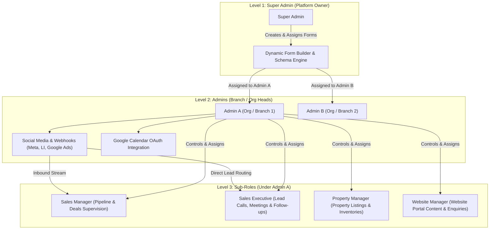
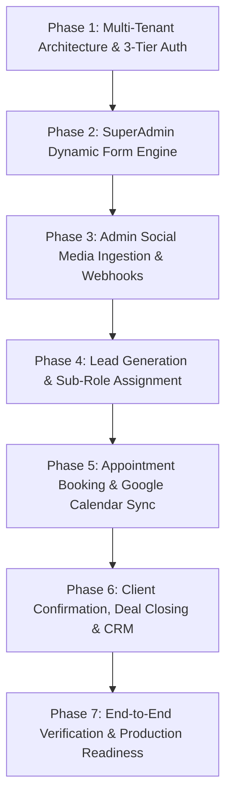

# Full Project Implementation Blueprint: 3-Tier Lead Management & CRM Engine

This document provides the **complete, end-to-end implementation architecture, phased delivery plan, and exhaustive test cases** tailored specifically to the **3-Tier Hierarchy Model**:
**Level 1: SuperAdmin (Platform Owner)** $\longrightarrow$ **Level 2: Admins (Branch / Org Heads)** $\longrightarrow$ **Level 3: Sub-Roles (Operational Staff under Admin)**.


---

## 1. System Hierarchy & Role Permission Matrix

### 3-Tier Governance Model

| Tier / Role                                                                              | Scope / Governance                                                 | Core Capabilities                                                                                                                                                                                                                                                                                                                                                                                                                                         |
| :--------------------------------------------------------------------------------------- | :----------------------------------------------------------------- | :-------------------------------------------------------------------------------------------------------------------------------------------------------------------------------------------------------------------------------------------------------------------------------------------------------------------------------------------------------------------------------------------------------------------------------------------------------- |
| **Level 1: SuperAdmin**<br>_(Platform Owner)_                                            | System-wide across all Admins/Organizations                        | • Provisions and controls Admins.<br>• **Creates & assigns Dynamic Forms** (JSON schema builder) to Admins.<br>• Global system settings, audit logs & cross-tenant overview.                                                                                                                                                                                                                                                                              |
| **Level 2: Admin**<br>_(Org / Branch Head)_                                              | Scoped to their own Organization/Branch                            | • Provisions & manages staff **Sub-Roles** (Sales Managers, Sales Executives, Property Managers, Website Managers).<br>• **Connects & configures Social Media** (Meta Ads, LinkedIn, Google Ads Webhooks).<br>• Manages organizational Google Calendar integration.<br>• Full visibility & CRUD over all Leads, Appointments, Confirmations, and Clients under their Org.<br>• Receives dynamic form templates assigned by SuperAdmin and activates them. |
| **Level 3: Sub-Roles**<br>_(e.g., Sales Manager, Sales Exec, Property Mgr, Website Mgr)_ | Scoped strictly to their assigned Admin and assigned Clients/Leads | • Operates under the **Admin’s Social Media Ingestion pipelines** (inbound leads stream into the shared Org pool or directly to assigned staff).<br>• Access to **Leads**, **Appointments**, **Client Confirmation**, and **Client Information** for their assigned scope.<br>• Conducts meetings, logs outcomes (`YES`, `NO`, `MAYBE`), and manages follow-ups on calendar schedules.                                                                    |



---

## 2. In-Depth Architectural Components

### A. Dynamic Form Builder (SuperAdmin $\longrightarrow$ Admin)

1. **Dynamic JSON Form Schema:** SuperAdmin designs custom input forms without code changes.
   - Field Types: `text`, `textarea`, `number`, `email`, `phone`, `date`, `select`, `checkbox`, `file`.
   - **Semantic Identity Mapping:** Fields bind semantically to canonical Lead properties (`client_name`, `client_phone`, `client_email`, `client_address`).
2. **Form Assignment to Admins:**
   - SuperAdmin assigns form templates to specific Admin accounts (`adminId`).
   - The Admin activates the form for their public landing pages or direct capture links.
   - Submissions through this form automatically stamp `adminId`, routing new leads directly into that Admin's pipeline.

### B. Social Media Ingestion Hub (Admin Level)

1. **Admin Social Connection Portal (`connect-social-media`):**
   - Each Admin enters their credentials/webhooks:
     - **Meta (Facebook/Instagram):** Page Access Token, Ad Account ID, Lead Gen Form IDs, App Secret.
     - **LinkedIn:** Client ID, Secret, OAuth Callback, Sponsored Form ID.
     - **Google Ads:** Webhook URL + Secret Google Ads Verification Key.
2. **Sub-Role Access Link:**
   - Inbound leads generated by the Admin's social channels are tagged with `adminId`.
   - Admin or automated routing rules assign incoming leads to specific **Sub-Roles** (`assignedSubRoleId` / `assignedUserId`).
   - Sub-Roles can view the origin campaign, platform source (Meta, LinkedIn, Google Ads), and form responses.

### C. Multi-Tenant Role Hierarchy & Data Scoping Rules

```typescript
// Core Data Scope Interceptor
export const buildAccessFilter = (
  user: { role: string; id: string; adminId?: string },
  query: any = {},
) => {
  const filter: any = { ...query };

  if (user.role === "superadmin") {
    // SuperAdmin has platform-wide access or can filter by specific adminId
    if (query.adminId)
      filter.adminId = new mongoose.Types.ObjectId(query.adminId);
    return filter;
  }

  if (user.role === "admin") {
    // Admin sees everything under their own organization
    filter.adminId = new mongoose.Types.ObjectId(user.id);
    return filter;
  }

  if (user.role === "subrole") {
    // Sub-role belongs to an Admin and sees assigned records (or department records)
    filter.adminId = new mongoose.Types.ObjectId(user.adminId);

    // Sub-role only sees leads/appointments assigned to them
    filter.$or = [
      { assignedSubRoleId: new mongoose.Types.ObjectId(user.id) },
      { createdById: new mongoose.Types.ObjectId(user.id) },
    ];
    return filter;
  }

  throw new Error("Unauthorized role");
};
```

---

## 3. Core Database Schemas for the 3-Tier Model

### 1. User & Hierarchy Schema (`User.model.ts`)

```typescript
interface IUser {
  name: string;
  email: string;
  passwordHash: string;
  role: "superadmin" | "admin" | "subrole";

  // Specific designation when role === "subrole"
  subRoleType?:
    | "Sales Manager"
    | "Sales Executive"
    | "Property Manager"
    | "Website Manager";

  // Scoping: SuperAdmin has null, Admin has null, Sub-roles point to their Admin
  adminId?: Types.ObjectId; // Reference to the Admin User

  permissions: {
    canViewAllOrgLeads?: boolean; // e.g. for Sales Manager
    canAssignLeads?: boolean;
    canCreateAppointments?: boolean;
    canConfirmClients?: boolean;
    canUploadInvoices?: boolean;
  };
  isActive: boolean;
  createdAt: Date;
}
```

### 2. Custom Form & Admin Assignment Schema (`CustomForm.model.ts`)

```typescript
interface ICustomForm {
  name: string;
  description?: string;
  fields: Array<{
    id: string;
    label: string;
    type:
      | "text"
      | "textarea"
      | "number"
      | "email"
      | "phone"
      | "date"
      | "select"
      | "checkbox";
    placeholder?: string;
    required: boolean;
    options?: string[];
    order: number;
    mapping:
      | "client_name"
      | "client_phone"
      | "client_email"
      | "client_address"
      | "none";
  }>;
  createdById: Types.ObjectId; // SuperAdmin
  version: number;
  isActive: boolean;
}

// Assignment to Admins
interface IFormAdminAssignment {
  formId: Types.ObjectId;
  adminId: Types.ObjectId; // Admin who received this form
  isActive: boolean;
  publicSlug: string; // e.g. /forms/org1-summer-promo
  assignedBy: Types.ObjectId; // SuperAdmin
  createdAt: Date;
}
```

### 3. Lead Schema (`Lead.model.ts`)

```typescript
interface ILead {
  leadTitle: string;
  clientName: string;
  clientPhone: string;
  clientEmail?: string;
  clientAddress?: string;

  source: "Meta" | "LinkedIn" | "GoogleAds" | "DynamicForm" | "Manual";
  campaignName?: string;
  adId?: string;
  rawSubmissionData?: Record<string, any>; // Answers from custom form or ad question maps

  status: "Pending" | "Assigned" | "In-Progress" | "Completed" | "Rejected";

  // Tier Scoping
  adminId: Types.ObjectId; // Owning Admin (Org Head)
  assignedSubRoleId?: Types.ObjectId; // Assigned Sub-role user (e.g. Sales Executive)
  assignedSubRoleName?: string;

  createdById: Types.ObjectId;
  createdAt: Date;
}
```

### 4. Appointment Schema (`Appointment.model.ts`)

```typescript
interface IAppointment {
  leadId: Types.ObjectId;
  clientName: string;
  clientPhone: string;
  clientEmail?: string;
  agenda: string;

  meetingType: "In-Person" | "Virtual" | "Call";
  meetingLocation?: string;
  meetingDate: Date;

  status: "Scheduled" | "Rescheduled" | "Cancelled" | "Completed";
  outcome?: "YES" | "NO" | "MAYBE";

  // Google Calendar Integration (Uses Admin's OAuth Connection)
  googleCalendarEventId?: string;
  googleCalendarLink?: string;

  // Tier Scoping
  adminId: Types.ObjectId;
  assignedSubRoleId: Types.ObjectId; // Host / Sales Executive

  createdAt: Date;
}
```

### 5. Client Confirmation & CRM Schema (`ClientConfirmation.model.ts`)

```typescript
interface IClientConfirmation {
  appointmentId: Types.ObjectId;
  leadId: Types.ObjectId;

  clientName: string;
  clientPhone: string;
  clientEmail?: string;
  deliveryOrSiteAddress?: string;

  clientConfirmation: "YES" | "NO" | "MAYBE";
  clientFeedback?: string;

  // Deal Won (YES): Final agreement / delivery date
  agreedDeliveryDate?: Date;

  // Decision Pending (MAYBE): Follow-up
  followUpDate?: Date;
  followUpGoogleCalendarEventId?: string;

  // Commercials
  quotationId?: Types.ObjectId;
  invoiceUrl?: string;

  adminId: Types.ObjectId;
  createdById: Types.ObjectId; // Sub-role or Admin
  createdAt: Date;
}
```

---

## 4. End-to-End Operational Lifecycle

```
[SuperAdmin]
    │
    └─► 1. Creates Dynamic Form Schema ──► Assigns Form to Admin
                                                 │
                                                 ▼
                                        [Admin Configuration]
                                                 │
                        ┌────────────────────────┴────────────────────────┐
                        ▼                                                 ▼
             Admin Configures Social Ads                     Admin Connects Google Calendar
             (Meta, LinkedIn, Google Ads)                               (OAuth 2.0)
                        │                                                 │
                        ▼                                                 │
         ┌──────────────────────────────┐                                 │
         │ Inbound Lead Generated       │                                 │
         │ (Social Webhook or Form)     │                                 │
         └──────────────┬───────────────┘                                 │
                        │                                                 │
                        ▼                                                 │
             [Admin or Auto-Assign]                                       │
                        │                                                 │
                        ▼                                                 │
             [Sub-Role (Sales Exec)]                                      │
             Reviews Lead in Dashboard                                    │
                        │                                                 │
                        ▼                                                 │
         Schedules Appointment with Client ───────────────────────────────┤
         (Virtual / In-Person)                                            │
                        │                                                 │
                        ├─────────────────────────────────────────────────┘
                        ▼
         Google Calendar Event Created
         (Sends Google Meet or Calendar Invites to Client & Sales Exec)
                        │
                        ▼
              [Meeting Takes Place]
                        │
                        ▼
         Sub-Role Logs Client Confirmation Outcome:
            ├──► YES: Deal Won ──► Binds Quotation / Invoice ──► Marks Lead Completed
            ├──► MAYBE: Sets Follow-Up Date ───────────────────► Auto-Syncs Call to Sales Exec Calendar
            └──► NO: Sets Rejection Reason & Closes Lead
                        │
                        ▼
         [Graduation to Client Information CRM Profile]
```

---

## 5. Complete Step-by-Step Implementation Roadmap



### Phase 1: Multi-Tenant Architecture & 3-Tier Auth

- [ ] Implement `User` model supporting `superadmin`, `admin`, and `subrole` (with sub-role types: Sales Manager, Sales Executive, Property Manager, Website Manager).
- [ ] Create JWT authentication middleware enforcing `role` and attaching `user.adminId`.
- [ ] Write `buildAccessFilter` utility to enforce automated scoping across all database queries.
- [ ] Build User Management UI:
  - SuperAdmin portal to create and manage Admin organizations.
  - Admin portal to create and manage Sub-Roles.

### Phase 2: SuperAdmin Dynamic Form Engine

- [ ] Build JSON-schema form generator in the SuperAdmin dashboard (`form-builder-dialog.tsx`, `frombuild.tsx`).
- [ ] Implement field configuration (Label, Type, Placeholder, Options, Validation, Semantic Mapping).
- [ ] Build Form Assignment module: SuperAdmin selects which Admin organizations receive each form.
- [ ] Build public form rendering page (`/forms/:publicSlug`):
  - Validates submission payload.
  - Stretches answers into dynamic attributes and auto-maps `client_name`, `phone`, `email` to canonical fields.
  - Creates a new `Lead` tagged with the assigned `adminId`.

### Phase 3: Admin Social Media Ingestion & Webhooks

- [ ] Build Admin Social Media Settings UI (`connect-social-media`):
  - Meta Ads Modal (App ID, App Secret, Page Token, Lead Gen Form ID).
  - LinkedIn Ads Modal (Client ID, Client Secret, Form ID).
  - Google Ads Modal (Webhook Key, Customer ID).
- [ ] Implement backend webhook listener endpoints:
  - `POST /api/webhooks/meta/:adminId` (HMAC SHA-256 validation).
  - `POST /api/webhooks/linkedin/:adminId`.
  - `POST /api/webhooks/google-ads/:adminId`.
- [ ] Extract standardized fields and insert into `Lead` repository with `adminId`.
- [ ] Provide deduplication logic based on `{ adminId, clientPhone }`.

### Phase 4: Lead Generation & Sub-Role Assignment

- [ ] Build Lead Table UI (`lead-table.tsx`):
  - Admin view: Sees all inbound leads across Meta, LinkedIn, Google Ads, and Dynamic Forms.
  - Sub-Role view: Sees assigned leads only (or department pool).
- [ ] Build Lead Assignment Dialog (`lead-assign-dialog.tsx`):
  - Admin or Sales Manager assigns leads to specific Sales Executives.
- [ ] Status workflow buttons: `Pending` $\to$ `Assigned` $\to$ `In-Progress` $\to$ `Schedule Appointment`.

### Phase 5: Appointment Booking & Google Calendar Sync

- [ ] Implement Admin Google Calendar OAuth 2.0 flow:
  - OAuth authorization endpoint with `offline` access to obtain a `refresh_token`.
  - Token refresh service per `adminId`.
- [ ] Build Appointment Dialog (`lead-appointmenAdd-dialog.tsx`, `appointment-meeting-table.tsx`):
  - Select meeting type: `In-Person`, `Virtual`, or `Call`.
  - Pick Date & Time Slot.
- [ ] Calendar Sync Service:
  - When saved, calls Google Calendar API using the Admin's OAuth credentials.
  - Invites Client email and Sub-Role (Sales Executive) email.
  - If `Virtual`, generates Google Meet link and saves it in the database.
  - Saves `googleCalendarEventId` on the appointment.

### Phase 6: Client Confirmation, Deal Closing & CRM

- [ ] Build Client Confirmation Dialog (`appointment-clientconfirm-dialog.tsx`, `client-confirmation-table.tsx`).
- [ ] Implement outcome triggers:
  - **Outcome = `YES` (Won):**
    - Capture agreed delivery/site details.
    - Link Quotation and allow Invoice upload (`invoiceUrl`).
    - Mark Lead as `Completed`.
  - **Outcome = `MAYBE` (Follow-up):**
    - Capture `followUpDate`.
    - Create follow-up call calendar event for the Sales Executive.
    - Mark Lead as `In-Progress`.
  - **Outcome = `NO` (Lost):**
    - Capture lost reasons and mark Lead as `Rejected`.
- [ ] Master CRM graduation: Confirmed clients automatically populate the unified `Client Information` directory.

### Phase 7: End-to-End Verification & Production Readiness

- [ ] Audit log verification: SuperAdmin reviews cross-admin activity; Admin reviews sub-role activity.
- [ ] Role Boundary Security Testing: Verify that a Sub-Role of Admin A cannot query, update, or view leads/appointments belonging to Admin B or other unassigned sub-roles.
- [ ] Webhook retry handling & Rate limiting on public dynamic forms.

---

## 6. Comprehensive Test Cases Suite

This test suite guarantees bullet-proof multi-tenancy, data boundary isolation, webhook processing, calendar synchronization, and lifecycle completion before production deployment.

### Category 1: Multi-Tenancy & Authorization Boundaries (RBAC)

| ID            | Test Scenario                | Steps                                                                                                   | Expected Outcome                                                                                           |
| :------------ | :--------------------------- | :------------------------------------------------------------------------------------------------------ | :--------------------------------------------------------------------------------------------------------- |
| **TC-SEC-01** | Cross-Admin Data Leakage     | 1. Authenticate as Sub-Role under Admin A.<br>2. Attempt `GET /api/leads/:leadId` belonging to Admin B. | **403 Forbidden** or **404 Not Found** returned. No data leaked across Admin boundaries.                   |
| **TC-SEC-02** | Sub-Role Scope Confinement   | 1. Authenticate as Sales Exec 1 under Admin A.<br>2. Request `GET /api/leads`.                          | Only leads assigned to Sales Exec 1 (or created by them) are returned. Other executive leads are excluded. |
| **TC-SEC-03** | Admin Full Visibility        | 1. Authenticate as Admin A.<br>2. Request `GET /api/leads`.                                             | All leads belonging to Admin A across all sub-roles are returned with complete assignment tags.            |
| **TC-SEC-04** | SuperAdmin Governance Access | 1. Authenticate as SuperAdmin.<br>2. Request `GET /api/leads?adminId=Admin_A_ID`.                       | System returns filtered leads for Admin A. SuperAdmin can audit any organization on demand.                |

---

### Category 2: Dynamic Form Builder & Admin Assignment

| ID            | Test Scenario                     | Steps                                                                                                                                     | Expected Outcome                                                                                                                                                                                       |
| :------------ | :-------------------------------- | :---------------------------------------------------------------------------------------------------------------------------------------- | :----------------------------------------------------------------------------------------------------------------------------------------------------------------------------------------------------- |
| **TC-FRM-01** | SuperAdmin Creates Dynamic Schema | 1. SuperAdmin designs form with `name`, `phone`, `budget` (number), and `preferred_property` (select).<br>2. Post to `/api/custom-forms`. | Form created successfully with version `1` and field validations.                                                                                                                                      |
| **TC-FRM-02** | Form Assigned to Multiple Admins  | 1. SuperAdmin assigns Form to Admin A and Admin B.<br>2. System generates unique slugs: `/forms/orgA-form` and `/forms/orgB-form`.        | Both assignments created with `isActive: true` mapped to respective `adminId`.                                                                                                                         |
| **TC-FRM-03** | Public Dynamic Form Submission    | 1. Submit public form payload to `/forms/orgA-form`.<br>2. Verify database records.                                                       | 1. Form validates successfully.<br>2. New `Lead` created with `adminId = Admin A`.<br>3. Semantic mappings populate `clientName` and `clientPhone`.<br>4. Custom fields stored in `rawSubmissionData`. |

---

### Category 3: Social Media Ingestion & Webhooks

| ID            | Test Scenario                       | Steps                                                                                                                                  | Expected Outcome                                                                                                                    |
| :------------ | :---------------------------------- | :------------------------------------------------------------------------------------------------------------------------------------- | :---------------------------------------------------------------------------------------------------------------------------------- |
| **TC-SOC-01** | Meta Webhook Signature Verification | 1. Send simulated Meta webhook with valid `X-Hub-Signature-256`.<br>2. Send another request with an invalid/tampered signature.        | 1. Valid signature returns `200 OK` and ingests lead.<br>2. Invalid signature returns **401/403 Unauthorized** and rejects payload. |
| **TC-SOC-02** | LinkedIn Lead Extraction            | 1. Send LinkedIn Lead Gen webhook payload to `/api/webhooks/linkedin/:adminId`.                                                        | System parses answer fields, resolves email/phone, tags `source: "LinkedIn"`, and binds `adminId`.                                  |
| **TC-SOC-03** | Inbound Lead Deduplication          | 1. Submit a lead via Google Ads webhook with phone `+1987654321`.<br>2. Resubmit identical phone within 24 hours under same `adminId`. | System detects existing lead, updates audit log or marks duplicate flag without creating duplicate clutter.                         |

---

### Category 4: Appointment Booking & Google Calendar Integration

| ID            | Test Scenario                    | Steps                                                                                             | Expected Outcome                                                                                                                                                                |
| :------------ | :------------------------------- | :------------------------------------------------------------------------------------------------ | :------------------------------------------------------------------------------------------------------------------------------------------------------------------------------ |
| **TC-CAL-01** | Google OAuth Token Auto-Refresh  | 1. Expire Admin's Google Calendar `accessToken` in DB.<br>2. Trigger appointment creation.        | System automatically calls Google token endpoint with stored `refreshToken`, saves new token, and creates event without user disruption.                                        |
| **TC-CAL-02** | Virtual Meeting with Google Meet | 1. Sales Executive creates appointment with `meetingType: "Virtual"`.<br>2. Provide client email. | 1. Appointment saved.<br>2. Google Calendar event created with attendees (Client + Sales Exec).<br>3. Google Meet conference link generated and stored in `googleCalendarLink`. |
| **TC-CAL-03** | Appointment Rescheduling Sync    | 1. Edit appointment date/time from Dashboard.<br>2. Save changes.                                 | Backend sends `PATCH` to Google Calendar API updating event time and notifying attendees.                                                                                       |
| **TC-CAL-04** | Appointment Cancellation Sync    | 1. Cancel appointment from UI.                                                                    | Event deleted from Google Calendar; appointment status set to `Cancelled`.                                                                                                      |

---

### Category 5: Client Confirmation & Deal Lifecycle

| ID             | Test Scenario                      | Steps                                                                                                                              | Expected Outcome                                                                                                                                                                                      |
| :------------- | :--------------------------------- | :--------------------------------------------------------------------------------------------------------------------------------- | :---------------------------------------------------------------------------------------------------------------------------------------------------------------------------------------------------- |
| **TC-CONF-01** | Outcome = "YES" (Deal Won)         | 1. Sub-role completes meeting and marks outcome `YES`.<br>2. Enters agreed delivery date, attaches quotation, and uploads invoice. | 1. Lead status updates to `Completed`.<br>2. Appointment status updates to `Completed`.<br>3. Client record created/updated in `Client Information`.<br>4. Invoice stored securely.                   |
| **TC-CONF-02** | Outcome = "MAYBE" (Follow-Up Call) | 1. Sub-role selects `MAYBE` and sets `followUpDate: 2026-11-05 10:00`.                                                             | 1. Lead status updates to `In-Progress`.<br>2. System creates a follow-up reminder event on Sales Executive's Google Calendar.<br>3. `followUpGoogleCalendarEventId` recorded on confirmation record. |
| **TC-CONF-03** | Outcome = "NO" (Lost Deal)         | 1. Sub-role selects `NO` with reason "Budget mismatch".                                                                            | 1. Lead status updates to `Rejected`.<br>2. Reason logged in historical timeline for conversion analytics.                                                                                            |

---

### Category 6: Edge Cases & System Resilience

| ID            | Test Scenario                             | Steps                                                                                           | Expected Outcome                                                                                                                                                     |
| :------------ | :---------------------------------------- | :---------------------------------------------------------------------------------------------- | :------------------------------------------------------------------------------------------------------------------------------------------------------------------- |
| **TC-RES-01** | Google Calendar API Outage / Disconnected | 1. Revoke OAuth credentials in Admin settings.<br>2. Schedule an appointment.                   | Appointment is still successfully saved in local DB with a warning status `calendarSyncFailed: true`. UI prompts Admin to reconnect Google account without crashing. |
| **TC-RES-02** | High Concurrency Dynamic Form Spikes      | 1. Send 100 simultaneous requests to public form slug.                                          | Rate limiter permits valid submissions; MongoDB compound indices ensure insertion without race conditions or memory spikes.                                          |
| **TC-RES-03** | Sub-Role Deactivation Impact              | 1. Admin deactivates a Sales Executive who has 10 active leads.<br>2. Admin checks Leads table. | System flags unassigned/orphaned leads for reassignment; deactivated user immediately loses API access.                                                              |
