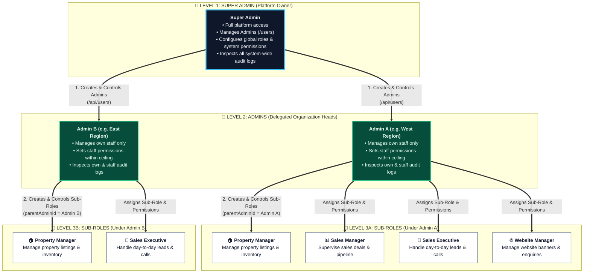

# Real Estate CRM - Phase 1 Architectural Code Flow & System Documentation

## 1. Executive Summary & Objective
Phase 1 establishes a production-grade, multi-tenant administrative engine and strict **Hierarchical Role-Based Access Control (RBAC)** architecture for the Real Estate CRM application.

The core objective is to deliver a secure, two-tiered administrative delegation model where:
1. **Super Admin** governs the platform, manages high-level administrative users (`admin` role), configures system-wide roles/permissions, inspects tenant-wide audit trails, and monitors top-level operations.
2. **Admin** manages their delegated organization and department staff (sub-roles: `property_manager`, `sales_executive`, `sales_manager`, `website_manager`), assigns granular action-matrix permissions capped strictly at their own ceiling, and inspects their own audit trail and that of their direct subordinates.
3. **Sub-Role Staff** possess limited operational access, restricted strictly to designated operational dashboards and execution tools without administrative or configuration exposure.

---

## 2. Hierarchical Role Architecture

### 2.1 Role Hierarchy Diagram (Super Admin ➔ Admin ➔ Sub-Roles)



### 2.2 Operational & Privilege Flow Diagram

```mermaid
flowchart LR
    %% Workflow & Access Flow
    subgraph S1["Super Admin Privileges"]
        A1["Manage Admin Users (/users)"]
        A2["Assign Any Roles & System Permissions"]
        A3["Inspect All Audit Logs (Platform-Wide)"]
        A4["Select Any Admin & Drill Down Staff"]
    end

    subgraph S2["Admin Privileges (Scoped Ceiling)"]
        B1["Manage Own Staff Sub-Roles (/staff)"]
        B2["Set Custom Permissions (<= Admin's Ceiling)"]
        B3["Inspect Own & Direct Staff Logs (/audit-logs)"]
        B4["❌ Cannot View or Create Other Admins"]
    end

    subgraph S3["Sub-Role Privileges (Operational)"]
        C1["Dashboard Operational View Only"]
        C2["Execute Assigned Tasks (Leads/Properties/Deals)"]
        C3["❌ No Access to Users, Staff, Roles, or Logs"]
    end

    S1 -->|"Delegates Scope"| S2
    S2 -->|"Delegates Tasks"| S3
```



### 2.2 RBAC Rules & Invariants
1. **Administrative Boundary**:
   - Only `super_admin` can create, edit, deactivate, or delete users with the `admin` or `super_admin` role.
   - Admins can **never** create or view other Admins; their visibility and creation scope is strictly restricted to sub-roles.
2. **Ceiling Enforcement (Permission Capping)**:
   - When an Admin assigns permissions or sub-roles to their staff, they **cannot** grant any module or action that they do not possess.
   - Any attempt to escalate privileges beyond the delegator's ceiling triggers an immediate `403 Forbidden` response.
3. **Data Ownership & Scoping**:
   - Super Admins can filter and view staff across any Admin or view all staff system-wide.
   - Admins can **only** view, edit, and audit staff where `parentAdminId == currentAdmin._id`.
   - Sub-role staff cannot access administrative menus, permission matrices, user tables, or audit logs.

---

## 3. Data Models & Database Schemas

### 3.1 User Schema (`src/models/User.ts`)
```typescript
{
  name: { type: String, required: true },
  email: { type: String, required: true, unique: true },
  username: { type: String, sparse: true },
  password: { type: String, required: true, select: false },
  role: { type: String, required: true }, // 'super_admin' | 'admin' | sub-roles
  status: { type: String, enum: ['active', 'inactive', 'suspended'], default: 'active' },
  
  // Hierarchical Delegation Paths
  parentAdminId: { type: mongoose.Schema.Types.ObjectId, ref: 'User', default: null },
  allowedSubRoles: [{ type: String }],
  
  // Custom User-Centric Permission Matrix Overlay
  customPermissions: [{
    module: { type: String, required: true },
    actions: [{ type: String }] // ['create', 'read', 'update', 'delete', 'export', 'import', 'assign', 'approve']
  }],

  // Optional identifiers with auto-generation fallback
  employeeId: { type: String, unique: true, sparse: true },
  mobile: { type: String },
  designation: { type: String },
  department: { type: String }
}
```

### 3.2 Role Schema (`src/models/Role.ts`)
```typescript
{
  name: { type: String, required: true, unique: true },
  displayName: { type: String, required: true },
  description: { type: String },
  isSystem: { type: Boolean, default: false },
  permissions: [{
    module: { type: String, required: true },
    actions: [{ type: String }]
  }]
}
```

### 3.3 Audit Log Schema (`src/models/AuditLog.ts`)
```typescript
{
  userId: { type: mongoose.Schema.Types.ObjectId, ref: 'User', required: true },
  action: { type: String, required: true },
  module: { type: String, required: true },
  targetId: { type: String },
  details: { type: mongoose.Schema.Types.Mixed },
  ipAddress: { type: String },
  userAgent: { type: String },
  createdAt: { type: Date, default: Date.now }
}
```

---

## 4. Complete Code Flow & API Architecture

```
User Action (Browser)
      │
      ▼
Client Component (Page / Form / SearchableSelect)
      │  (JSON Request + HttpOnly Cookie)
      ▼
Next.js Route Handler (/api/*)
      │
      ├── [1] requireAuth() / getSession() ──► Extract JWT, verify signature & expiry
      │                                    ──► Check User status in DB (reject inactive/suspended)
      │                                    ──► Merge Role Permissions + User customPermissions
      │
      ├── [2] requireRole() / Permission Check ──► Super Admin check or ceiling validation
      │
      ├── [3] Service Layer (userService, staffService, auditService)
      │                                    ──► Execute business logic
      │                                    ──► Validate MongoDB constraints & unique IDs
      │
      ├── [4] Audit Log Service ──────────► Record actor, action, target, IP & metadata
      │
      ▼
JSON Response (Standardized: { success: boolean, data?: any, error?: string })
```

---

## 5. Module-by-Module Code Flow & Changes Made

### 5.1 Authentication & Session Overlay (`src/lib/auth/session.ts`)
- **Flow**:
  1. On every authenticated request, `requireAuth()` inspects `crm_access_token`.
  2. Resolves the database user to verify their status (`active`). If deactivated, invalidates the session with `401/403`.
  3. Loads base permissions from the user's `Role` model.
  4. **Custom Permission Overlay**: If `user.customPermissions` are configured on the user record, they override/augment base role permissions, enabling per-user granular access control.
- **Key Changes**:
  - Integrated `customPermissions` merging algorithm inside `getSession()`.
  - Added immediate database invalidation for suspended accounts.

### 5.2 Admin User Management (`/users` & `/api/users`)
- **Access**: Restricted exclusively to `super_admin`.
- **Flow**:
  1. Super Admin manages `admin` accounts (name, email, phone, status, password).
  2. Sub-roles are hidden from this view to enforce privilege separation.
  3. `employeeId` input is optional; if omitted, `userService` generates a collision-free identifier.
- **Key Changes**:
  - Removed mandatory Employee ID and Username inputs from the UI.
  - Added Show/Hide password toggle (eye icon) on password inputs.
  - Excluded sub-role staff from the `/users` table to avoid confusion with organization administrators.

### 5.3 Staff Management (`/staff` & `/api/staff`)
- **Access**: `super_admin` and `admin`.
- **Flow**:
  1. **For Super Admin**:
     - Can select a specific Admin from a debounced searchable dropdown (`SearchableSelect`).
     - Can view all staff belonging to the selected Admin, or view all platform staff globally.
     - Can create staff under any chosen Admin with sub-roles (`property_manager`, `sales_executive`, etc.).
  2. **For Admin**:
     - Cannot see other Admins.
     - Sees only staff where `parentAdminId === currentAdmin._id`.
     - Can create staff under their own administration.
- **Key Changes**:
  - Created `/api/staff` and `/api/staff/[id]` with automated parent linkage and ownership verification.
  - Added debounced `SearchableSelect` for Admin selection by Super Admin.
  - Auto-generated `employeeId` (`STF...`) when left blank in staff creation.
  - Removed redundant username and employee ID fields from creation dialogs.
  - Added password visibility toggles.

### 5.4 Roles & Permissions Matrix (`/roles` & `/api/permissions/user/[userId]`)
- **Access**: `super_admin` and `admin`.
- **Architecture**: Shifted from generic role-only editing to a **User-Centric Granular Matrix**:
  1. Admin selects a user via a debounced searchable dropdown (`SearchableSelect`).
  2. The system loads that user's effective permissions across all 11 modules:
     - `leads`, `properties`, `deals`, `contacts`, `campaigns`, `documents`, `tasks`, `analytics`, `users`, `roles`, `audit_logs`.
  3. Supported Actions (8-Action Grid):
     - `create`, `read`, `update`, `delete`, `export`, `import`, `assign`, `approve`.
  4. **Ceiling Enforcement**:
     - Super Admins can grant any action across all modules.
     - Admins can **only** grant actions and modules that their own Admin account possesses. Modules/actions beyond their ceiling are automatically disabled in the UI and rejected on the backend.
- **Key Changes**:
  - Created `src/app/api/permissions/user/[userId]/route.ts` with ceiling validation.
  - Created `src/components/ui/SearchableSelect.tsx` with server-side debounced search.
  - Built an interactive 8-action permission table with Quick Action bulk controls ("Select All", "Read Only", "Clear All").

### 5.5 Hierarchical Audit Trail (`/audit-logs` & `/api/audit-logs`)
- **Access**: `super_admin` and `admin`.
- **Flow**:
  1. **Super Admin**:
     - Hierarchy filter tabs: **All Logs**, **My Logs (Super Admin)**, or **Admin Drill-Down**.
     - When inspecting an Admin: can review the Admin's logs, filter by sub-role category (e.g. Sales, Properties), and drill down into specific subordinate users.
  2. **Admin**:
     - Hierarchy filter tabs: **My Activity** or **Staff Activity**.
     - Can filter staff by sub-role category and select individual subordinates to inspect their actions.
- **Key Changes**:
  - Enhanced `/audit-logs/page.tsx` with hierarchical drill-down controls and responsive tabs.
  - Implemented server-side scoping in `/api/audit-logs` ensuring Admins cannot query logs outside their delegated staff.

### 5.6 Shell & Navigation Polish
- **Dynamic Breadcrumbs (`src/components/layout/Header.tsx`)**:
  - Replaced the static `"MongoDB Connected"` badge with dynamic, route-aware breadcrumbs (e.g., `Dashboard / Staff / Manage`).
- **Logout Confirmation Modal (`src/components/layout/Header.tsx`)**:
  - Replaced immediate logout with a modal alert dialog (`@radix-ui/react-alert-dialog`).
  - Clicking "Yes, Sign Out" displays an inline loading spinner, disables buttons to prevent duplicate requests, and navigates cleanly to `/login`.
- **Role-Based Sidebar Navigation (`src/components/layout/Sidebar.tsx`)**:
  - **Super Admin**: Full visibility (`Dashboard`, `Admins`, `Staff`, `Roles & Permissions`, `Audit Logs`).
  - **Admin**: Delegated visibility (`Dashboard`, `Staff`, `Roles & Permissions`, `Audit Logs` — `Admins` hidden).
  - **Sub-Roles**: Operational view only (`Dashboard` visible; administrative management tabs hidden).
- **Dashboard Layout (`src/app/(dashboard)/dashboard/page.tsx`)**:
  - Fixed management overview cards to display 4-in-a-row on desktop (`lg:grid-cols-4`).
  - Implemented role-tailored dashboard views: Super Admin metrics vs. Admin delegated stats vs. Sub-Role staff personalized welcome portal.

---

## 6. API Endpoint Reference

| Method | Endpoint | Allowed Roles | Description |
|---|---|---|---|
| `POST` | `/api/auth/login` | Public | Authenticates credentials, returns user payload, sets HttpOnly cookie |
| `POST` | `/api/auth/logout` | Authenticated | Clears auth cookie and invalidates session |
| `GET` | `/api/auth/me` | Authenticated | Returns current authenticated user and effective permissions |
| `GET` | `/api/users` | `super_admin` | Lists system administrator users with search & pagination |
| `POST` | `/api/users` | `super_admin` | Provisions a new Administrator user |
| `PUT` | `/api/users/[id]` | `super_admin` | Updates an Administrator's details or status |
| `DELETE`| `/api/users/[id]` | `super_admin` | Deletes an Administrator user |
| `GET` | `/api/staff` | `super_admin`, `admin` | Lists subordinate staff (scoped to delegator or filtered by Admin) |
| `POST` | `/api/staff` | `super_admin`, `admin` | Creates subordinate staff under delegating Admin |
| `PUT` | `/api/staff/[id]` | `super_admin`, `admin` | Updates staff member under delegating Admin |
| `DELETE`| `/api/staff/[id]` | `super_admin`, `admin` | Deletes staff member under delegating Admin |
| `GET` | `/api/permissions/user/[userId]` | `super_admin`, `admin` | Fetches target user's custom permissions and delegator ceiling |
| `PUT` | `/api/permissions/user/[userId]` | `super_admin`, `admin` | Saves custom permission matrix with ceiling validation |
| `GET` | `/api/audit-logs` | `super_admin`, `admin` | Fetches scoped audit logs with action/module/user filters |

---

## 7. Verification & Quality Assurance

- **Type Safety**: Verified with `npx tsc --noEmit` yielding **0 errors**.
- **Unit & Integration Tests**: Core authorization logic, session overlay, workflow transitions, and lead visibility test suites passing.
- **Design Consistency**: Standardized Tailwind CSS palette (Slate / Blue / Emerald), Lucid React icons, and Radix UI dialog primitives across all dashboard views.

