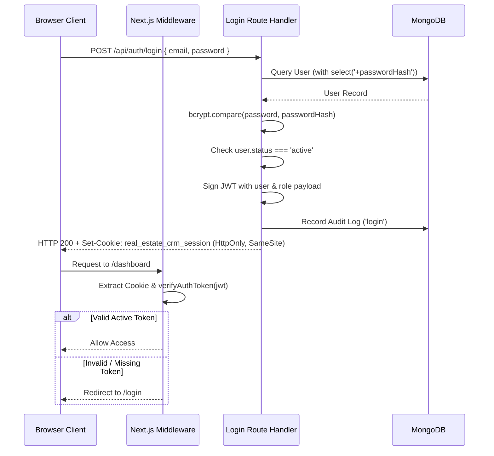

# Access Control Architecture Specification

This document details the security and access control architecture for the Real Estate CRM, specifying the authentication pipeline, Role-Based Access Control (RBAC), record-level lead visibility policies, and account lifecycle management.

---

## 1. Authentication & Session Pipeline

The platform uses a stateless, signed JSON Web Token (JWT) architecture managed by the Edge-compatible `jose` library, stored in secure HTTP-only cookies.



### Cookie Security Properties
- **HttpOnly**: Inaccessible to browser JavaScript, mitigating XSS token theft.
- **SameSite=Lax**: Protects against Cross-Site Request Forgery (CSRF).
- **Secure**: Transmitted over HTTPS in production environments.
- **MaxAge**: 8 hours (28,800 seconds).

---

## 2. Multi-Tier Authorization Model

The authorization model separates request processing into four distinct validation stages:

1. **Authentication**: Who is making the request? (Verified via session JWT and active DB state).
2. **Module Access**: Is the user's role granted access to the target module?
3. **Action Authority**: Does the user possess the specific action permission (`view`, `create`, `edit`, `delete`, `export`, `assign`, `publish`, `approve`)?
4. **Record Visibility & Query Scoping**: Which specific records is the user allowed to view or mutate?

### Fail-Closed RBAC Engine (`src/policies/permissionPolicy.ts`)
- Null, undefined, or malformed roles automatically evaluate to `false`.
- Permissions are strictly additive; actions not explicitly enumerated are denied.
- Operations are isolated:
  - `view` does **not** grant `edit` or `export`.
  - `edit` does **not** grant `publish` or `approve`.
  - `create` does **not** grant `assign`.

---

## 3. Record-Level Lead Visibility Policy (Section 50)

Section 50 specifies three lead visibility scopes:

```text
┌────────────────────────────────────────────────────────┐
│                      Company Scope                     │
│      Super Admin, Admin, Executive Management          │
│              Query Filter: {} (All records)            │
└──────────────────────────┬─────────────────────────────┘
                           │
┌──────────────────────────▼─────────────────────────────┐
│                       Team Scope                       │
│                     Sales Manager                      │
│        Query Filter: { team: user.team }               │
└──────────────────────────┬─────────────────────────────┘
                           │
┌──────────────────────────▼─────────────────────────────┐
│                     Assigned Scope                     │
│                     Sales Executive                    │
│        Query Filter: { assignedTo: user._id }          │
└────────────────────────────────────────────────────────┘
```

### Parameter Tampering Protection (`canAccessLeadRecord`)
Direct ID manipulation in URLs (e.g., attempting `GET /api/leads/lead-002` while assigned only to `lead-001`) is checked server-side before any record data is serialized or returned. Unauthorized attempts fail closed.

---

## 4. Account Lifecycle & Deactivation Security

1. **Activation State Enforcement**:
   - Every authenticated request verifies that `user.status === 'active'`.
   - If an administrator marks an account as `inactive`, subsequent requests by that token fail immediately with HTTP 403 Forbidden.
2. **Historical Preservation**:
   - Deactivating a user does **not** delete their user document from MongoDB.
   - Lead assignments, audit logs, and transaction histories retain valid foreign-key references to the user.
3. **Super Admin Protection**:
   - The system prevents deactivating or stripping permissions from the last remaining active Super Administrator account.
