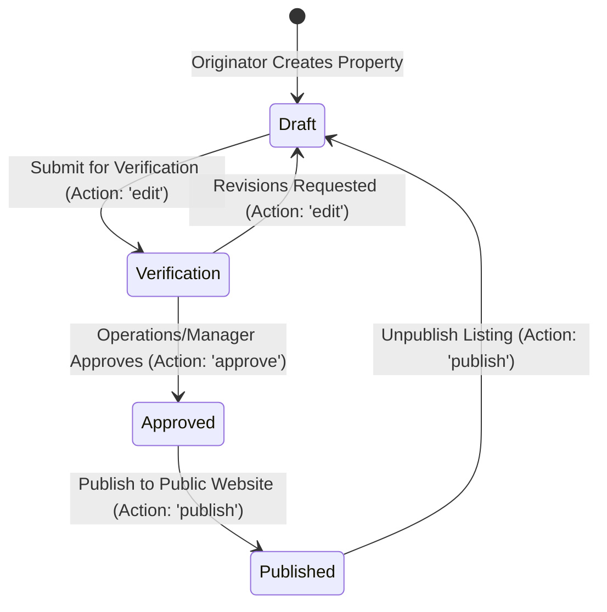
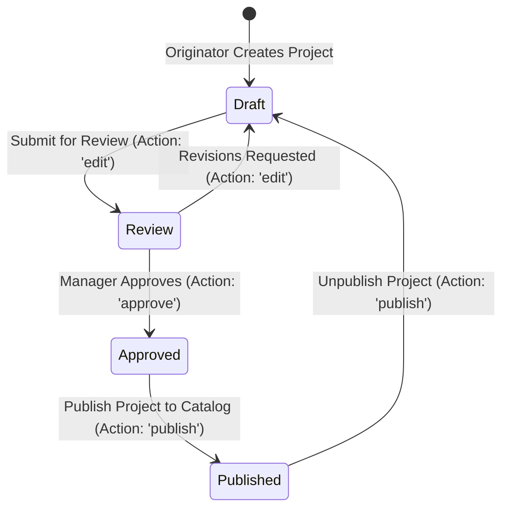
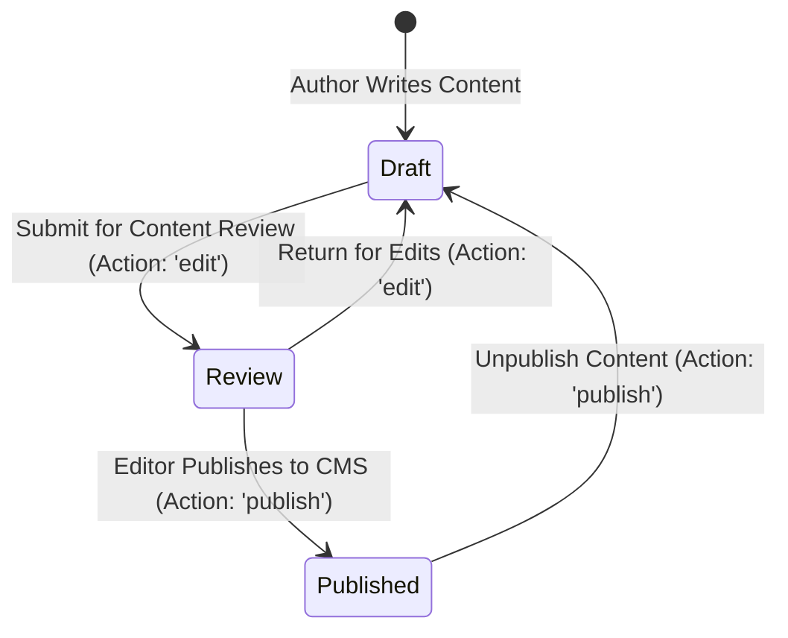

# Approval & Controlled Publishing Workflows

This document specifies the state machines, permission requirements, and audit events governing controlled publication workflows as defined in Section 51 of the specification.

---

## 1. Controlled Workflow State Machines

### 1.1 Property Publication Workflow

- **Draft → Verification**: Triggered by Property Manager, Sales Executive, or Admin who has `edit` permissions on `properties`.
- **Verification → Approved**: Requires explicit `approve` permission on `properties`. (Typically Property Manager or Admin).
- **Approved → Published**: Requires explicit `publish` permission on `properties`. Property is made available to public website APIs.
- **Published → Draft**: Requires `publish` permission (unpublish operation). Automatically removes property from active website search results and generates an audit log.

---

### 1.2 Project Publication Workflow

---

### 1.3 Website Content Workflow

---

## 2. Permission Gate Matrix for State Transitions

| Transition | Target Entity | Required Action Permission | Permitted Roles |
| :--- | :--- | :--- | :--- |
| `draft` → `verification` | Property | `edit` | Super Admin, Admin, Property Manager, Sales Executive |
| `verification` → `approved` | Property | `approve` | Super Admin, Admin, Property Manager |
| `approved` → `published` | Property | `publish` | Super Admin, Admin, Website Manager (when granted) |
| `published` → `draft` | Property | `publish` | Super Admin, Admin, Website Manager |
| `draft` → `review` | Project | `edit` | Super Admin, Admin, Property Manager |
| `review` → `approved` | Project | `approve` | Super Admin, Admin, Property Manager |
| `approved` → `published` | Project | `publish` | Super Admin, Admin |
| `draft` → `review` | Website Content | `edit` | Super Admin, Admin, Website Manager |
| `review` → `published` | Website Content | `publish` | Super Admin, Admin, Website Manager |

---

## 3. Workflow Audit Trail Integration

Every state transition triggers an audit event in MongoDB (`AuditLog` collection):
- **Actor**: User ID, Name, Email, and Role.
- **Action**: `status_change` or `publish` / `unpublish`.
- **Entity**: `property`, `project`, or `website_content`.
- **Entity ID**: Target document ObjectId.
- **Old Values vs New Values**: Captures `{ status: 'verification' }` → `{ status: 'approved' }`.
- **Timestamp & Source**: ISO 8601 UTC timestamp and requesting channel (`web_app` or `api`).
